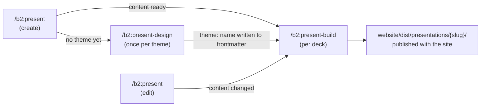

# Presentations
*Last verified: 2026-07-22*

b2 can turn a topic into a live, animated, presenter-ready HTML deck — published alongside your
website, built from a markdown file you keep editing in Obsidian (or any editor) for as long as the
presentation lives. This doc explains the whole subsystem: the three commands, the mechanisms that
make surgical re-builds safe, the file layout, and where the rough edges are.

## Overview

Three commands, each with a distinct job — deliberately mirroring the website's
talk/write → design → build shape so the mental model transfers:

| Command | Job | Runs |
|---|---|---|
| `/b2:present` | Talk through the idea, write the content markdown. Mode-detects create vs. edit. | Anytime, per deck |
| `/b2:present-design` | Design a **presentation theme** — visual language, motion, slide-component patterns. | Once per theme, not once per deck |
| `/b2:present-build` | Apply a theme to a deck's markdown, render or surgically update the live HTML. | Per deck, on demand |

A **theme** and a **deck** are independent, deliberately decoupled — the same relationship as one
website theme serving every page. Design the theme once; build any number of presentations against
it. A deck links to its theme with a single frontmatter field.



## Prerequisites

A locked website theme (`website/theme/{THEME}/design.md`, from `/b2:design`). Presentation themes
are explicitly an *extension* of the website's design language, not a fresh start — `/b2:present-design`
refuses to run without one.

## Step by Step

### 1. Create a presentation — `/b2:present`

No existing deck at that slug → create mode, four phases (unchanged from before this feature's
redesign, this part isn't new):

1. **Context harvest** — silently reads any `docs/product/*` and notes present; asks occasion,
   duration, background material.
2. **Strategic interview** — Duarte-style, Socratic: the one thing, the audience, the goal, the
   enemy, the proof, the hook, the three movements. Ends with a synthesis check you must confirm.
3. **Outline approval** — a slide-by-slide arc, iterated until you explicitly approve.
4. **Markdown generation** — writes `docs/presentations/{slug}/{slug}.md`. Then resolves a theme
   automatically (see [Theme resolution](#theme-resolution) below) and offers to dispatch
   `/b2:present-design` (no theme yet) or `/b2:present-build` (theme resolved, content ready).

### 2. Design a theme — `/b2:present-design`

Run once. Grounds itself in `website/theme/{THEME}/design.md` and `website/docs/decisions.md` —
confirms what's already established, then asks only the gaps: stage context (conference / client
room / webinar), motion intensity (minimal / moderate / dynamic), audience. Proposes 2-3 directions,
each an explicit stage adaptation of the website's existing look, not a new palette. Generates one
mockup HTML file per direction — a fixed 6-slide sample set (title, section/agenda, content+bullets,
data/chart, image-forward, closing) rendered full-viewport, stacked — reviewed in a gallery at
`website/presentation-mockups/index.html` (same gallery mechanism as `website/mockups/`, a separate
instance). If a real deck already exists (`docs/presentations/*/*.md`), its most recently modified
file seeds the sample slides' tone and subject — adapted, not pasted verbatim, and still covering
all 6 required types; otherwise sample content is invented as before. Iterate in place, then lock:
writes `website/presentation-themes/{name}/`. Locking runs a one-time verification: if a real deck
exists, builds it against the just-locked theme and diffs computed styles (type scale, colour,
spacing) against the approved mockup, catching drift a mockup-only review would miss (e.g. an
un-inherited base theme producing a mismatched font size). No real deck yet → verification is
skipped and reported as pending, not silently dropped.

**Theme CSS/JS paths must be root-relative** (`/theme/...`), never relative (`../assets/...`) —
theme files are copied to multiple directories across the build pipeline, and a relative path
resolves differently at each copy location.

Running it again later — either to create a **second, differently-named** theme, or to redesign an
existing one — is fully supported; nothing about the mechanism assumes only one theme exists.

### 3. Build — `/b2:present-build {slug}`

Applies the resolved theme, produces or updates `website/dist/presentations/{slug}/index.html`.
Default mode is **per-slide interactive**: each new/changed slide is proposed, shown live in a
browser, accepted or revised — an accept syncs both the built HTML and the source `.md` in one step.
This is the step with real mechanism underneath it — see [How It Works](#how-it-works).

### 4. Edit — `/b2:present`

Naming an existing slug switches to edit mode: no re-interview, surgical content changes only
(add/cut/reorder/rewrite slides). Never touches slide ids or generated HTML — that identity and
rendering work belongs entirely to `/b2:present-build`, run again afterward.

## How It Works

### The two-level source model

- **Level 1 — markdown**, `docs/presentations/{slug}/{slug}.md`. Content, structure, and *light*
  intent (layout/visual hints as comments). Obsidian-previewable via a Slides Extended-compatible
  reveal.js dialect. This is what you actually edit, day to day.
- **Level 2 — generated HTML**, `website/dist/presentations/{slug}/index.html`. Rich, bespoke
  `<section>` markup with real per-slide craft (custom SVG, animation, data visualization) — this is
  where the "hand-crafted, not templated" quality lives, and it survives content edits elsewhere in
  the deck because of the reconcile mechanism below.

Never hand-edit the generated HTML — it's regenerated/reconciled from the markdown on every build.

### The markdown dialect

Native reveal.js primitives, no bespoke syntax invented:

```markdown
<!-- .slide: id="the-enemy" -->
## Everyone in this room believes something false

[content]

<!-- Visual: split-screen — dense text vs one bold sentence -->

Note:
- [keyword]
- [keyword]

[what to say]

---

<!-- .slide: id="backup-data" data-visibility="hidden" -->
## [a hidden slide — still built, reachable from presenter overview]
```

- `<!-- .slide: id="..." -->` — every slide's stable identity. **You never write this yourself** —
  `/b2:present-build` backfills it automatically on first build.
- `data-visibility="hidden"` — skipped in linear next/prev navigation, still rendered, still
  reachable from the presenter overview (the PowerPoint hidden-slide trick). `hidden ≠ confidential`.
- `<!-- .element: class="fragment" -->` on any element — reveals it as its own step.
- `Note:` — speaker notes, shown in presenter view. Structure is keyword bullets first (up to the
  first blank line, for a mid-talk glance), then full rehearsal prose ending with a `Transition:`
  line — position, not a header, is the convention.
- `---` — horizontal slide separator only; this dialect is deliberately linear (no vertical stacks).

### Theme resolution

Every build reads the deck's `theme:` frontmatter:

| State | Behavior |
|---|---|
| Set, theme folder exists | Used as-is |
| Set, theme folder missing | Treated as unset (stale reference), falls through below |
| Unset, zero themes exist | Halts: run `/b2:present-design` first |
| Unset, exactly one theme | Used silently, written into frontmatter |
| Unset, multiple themes | Asks which one, defaults to the most recently created |

### Slide-id backfill

Runs first, on every build, before anything else. Any slide missing an id gets one generated from
its heading (slugified, collision-suffixed). A user who copy-pastes a slide (duplicating its id
comment too) has the second occurrence silently reassigned a fresh id. This makes even a
hand-written or pre-existing deck self-consistent before reconcile logic ever runs.

### Reconcile — the surgical-update mechanism

The reason editing one slide doesn't regenerate the whole deck. No custom diff/patch engine —
mirrors the same git-diff-and-interpret pattern the website build (`/b2:sync`) already uses for
pages:

1. If `website/dist/presentations/{slug}/index.html` itself has **uncommitted git changes**, stop
   before reconciling at all — reconciling against an output git doesn't know about risks silently
   discarding or misreading those edits. Ask the user to commit first, or proceed with the no-git
   path below (working-tree state becomes the baseline; that specific pre-build state won't be
   recoverable from history afterward).
2. Otherwise, find the commit that last touched that file — that's "since the last build" — and run
   one `git diff {that-commit} -- {deck.md}` call (committed + uncommitted changes together, one
   consistent set of hunks — not two diffs stitched together, which would compare mismatched file
   versions and could misclassify a slide).
3. Classify every slide id:

| Classification | Git path (diff-based) | No-git path (content-compare) |
|---|---|---|
| Unchanged | No diff hunk in the id's range | Id's `.md` content matches what's rendered in its `<section>` |
| Changed | Diff hunk falls in the id's range → regenerate | `.md` content differs from rendered section → `.md` wins, regenerate |
| New | Id in source, not in prior output → generate fresh | Same |
| Moved | Content byte-identical across revisions, position differs → relocate, don't regenerate | Same content, different position → relocate |
| Removed | Id in prior output, gone from source → drop silently | Drop only after asking the user — no git history to recover it from if wrong |

Moved detection deliberately compares the slide's markdown content directly rather than trusting "no
diff hunk" — a plain line-based diff reports a moved block as a delete-and-insert pair, which would
otherwise misclassify it as changed.

**No git repository** reuses the same per-slide-by-id parsing built for the git path, applied
without a diff to anchor to — an AI content-compare, not a diff. This **reverses prior behavior**
(a full unconditional regenerate on every no-git build): silent full regeneration risked losing
hand-crafted design with no way to recover it, so it's semantic per-slide recovery now, with removal
gated behind a confirmation since it's the one classification a wrong call can't undo. On this path
the build also tells the user once: keep the project under git, or rely on the interactive
visual-first flow (below) which writes source and output together so they can't drift apart.

### Sequential, deck-wide generation

Every slide classified changed/new is authored **in one continuous pass, in deck order**, with each
finished `<section>` appended to the output immediately (the file's shell — doctype, empty
`.slides` container, init script — is written once up front; there's no longer a separate end-of-pass
assembly step). This is a deliberate contrast with `/b2:present-design`'s mockups, where 2-3 concepts
are *supposed* to diverge from each other (parallel, isolated agents). A single deck needs the
opposite: one coherent visual and motion language end to end, which requires the whole deck in view
while authoring, not fragments generated blind to their siblings.

### Visual-first collaboration

Default build mode: **per-slide interactive**. For each new/changed slide, propose a visual
treatment if one would carry the message better than text, append the candidate section, and ask the
user to check it live (`.../index.html#/{id}`, via a running `/b2:serve`) — like it or adjust. One
accept bundles three things atomically: keep the visual, move any displaced text into that slide's
notes, and sync the same content back into the source `.md` — no separate sync-permission prompt,
since the user already saw the live result before accepting. Two alternate modes, chosen once up
front (not re-asked per slide): **batch** (all proposals shown together, one approval round) and
**passive** (no proposals unless explicitly requested).

### Theme cross-sync

Mid-build, if a slide's need looks like a theme-level gap rather than a one-off tweak, the build
counts how many decks (`docs/presentations/*/*.md`) use `theme: {name}`. Only this deck on the theme
→ judged and applied directly to the theme files, no permission ask (verified before the build
reports done). 2+ decks on the theme → asks first, since the blast radius isn't provably zero.

### Capture ratchet

While building, genuine bugs fixed mid-slide (real defects — wrong values, race conditions, broken
layout, not taste preferences) are tracked silently, then raised once as a batched question before
the report: keep the fix local to this theme's `design.md` Anti-Patterns section, or promote it to
the plugin-wide `shared/design/implementation-gotchas.md` so every theme benefits.

### Verification

Runs after generation, before the report — reuses `ui-review-expert`'s existing browser-detection
order (MCP → `npx playwright` → CLI → halt), no new tooling:

| Tier | Scope | Runs |
|---|---|---|
| 1 | Drive reveal.js through every slide, collect console errors | Always |
| 2 | One screenshot of reveal.js's built-in Overview mode | Always |
| 3 | Full-resolution screenshot + sampled computed-style/timing check | Only new/changed slides with a custom visual, illustration, or animation — **and** only if no human already approved it live via the interactive loop above (batch/passive modes, or an auto-applied theme cross-sync) |

A material Tier 3 defect is fixed and re-checked before the report is written.

### The shared runtime

`website/dist/presentations/shared/` has two independently-lifecycled parts:

- **`shared/reveal/`** — the reveal.js core (self-hosted, not CDN, so a live talk never depends on
  venue wifi). Vendored **once**, from a pinned npm tarball version, reused by every deck on every
  theme forever after.
- **`shared/themes/{theme}/`** — that theme's `theme.css`/`theme.js`, namespaced per theme, copied
  **on every build**. This is what makes a theme edit (from re-running `/b2:present-design`)
  propagate to every deck built on it, and what lets two different themes coexist without one
  clobbering the other's live CSS.

### Client variants and handouts

No special mechanism — a client-specific version is just another slug: copy
`docs/presentations/{slug}/` to `docs/presentations/{variant-slug}/`, edit/hide slides for that
engagement, build it. Its own independent output, its own stable URL. The live presentation and the
after-the-fact handout are the same URL — presenter view is a client-side mode switch (press `S`),
not a separate export.

## File & Folder Structure

```
docs/presentations/{slug}/
  {slug}.md              source of truth — content + light intent, Obsidian-previewable
  work.md                research/notes/drafts (optional, never pulled into slides directly)
  assets/                deck-specific images, copied into the build when referenced

website/presentation-themes/{name}/
  design.md              slide-oriented design guide (colour, type, per-slide-type patterns)
  theme.css               the design contract present-build-expert extends per slide
  theme.js                shared JS (motion setup, reveal-event hooks) — not per-slide logic
  preview.css              simplified subset for the Obsidian Slides Extended preview

website/presentation-mockups/
  concept-1.html, concept-2.html, ...    one per proposed direction
  index.html                              gallery — thumbnails, notes, open full-screen

website/dist/presentations/
  shared/reveal/                          reveal.js core, vendored once, shared by every deck
  shared/themes/{theme}/                  per-theme CSS/JS, refreshed every build
  {slug}/index.html                       the live, built deck — published with the site
```

**Never hand-edit:** anything under `website/dist/presentations/` — fully regenerated/reconciled by
`/b2:present-build`. **Safe to hand-edit:** `docs/presentations/{slug}/{slug}.md` — that's the whole
point; edit it in Obsidian, then re-run `/b2:present-build {slug}`.

## Presenter View

Built into reveal.js, no server required: press `S` once the deck is open in a browser, opens a
same-origin popup synced via `postMessage`/`localStorage` — current slide, speaker notes, next-slide
preview, timer, clock. Deep links to any slide: `{slug}/index.html#/{slide-id}`. Touch, keyboard,
and mouse navigation all work without configuration (reveal.js defaults).

## Where It Might Not Work

- **No git repository, or the deck's prior output was never committed.** Reconcile falls back to
  content-compare per slide instead of a diff — recovers unchanged/moved slides correctly in most
  cases, but has no history to fall back on, so a removed slide always asks for confirmation instead
  of dropping silently. Commit your `website/dist/presentations/` output if you want the more
  reliable diff-based path.
- **The output file has uncommitted changes when a build starts.** Reconcile stops and asks before
  touching anything — commit those changes first, or accept that the pre-build state won't be
  recoverable from git history afterward.
- **Very large decks.** Sequential deck-wide generation trades speed for coherence — a large deck's
  full-context single pass is a heavier single build step than a hypothetical parallel-per-slide
  approach would be. No mitigation built for this; not yet observed as a real problem.
- **The mockup phase's fixed 6-slide sample set** doesn't preview every layout a real deck might
  need (a pure-quote slide, a two-speaker slide, etc.) — `/b2:present-build` still applies the
  theme's design contract to unforeseen slide types reasonably, but you won't have seen it in the
  mockup gallery first.
- **Exact Obsidian preview fidelity.** The markdown dialect targets Slides Extended, but which
  community plugin renders it (and how faithfully) is outside b2's control — the build output is
  always the source of truth for how the deck actually looks; treat the Obsidian preview as a
  content/flow check, not a design preview.
- **Not implemented (deferred, tracked in the b2 project backlog):** a `--handout` mode that strips
  hidden slides from the output entirely (today, hidden just means skipped-in-flow-but-present), and
  presenter-view access gating separate from the public deck URL.

## FAQ

**Do I need to write the `.slide:` id comments myself?** No — never hand-write them.
`/b2:present-build` assigns and writes them back to your markdown automatically.

**I edited one slide — will the whole deck re-render?** No. Only that slide (and any others you
touched) regenerate; everything else is copied forward from the existing build untouched. This is
the entire reason the reconcile mechanism exists — see [How It Works](#reconcile-the-surgical-update-mechanism).

**Can I have more than one presentation theme?** Yes — `/b2:present-design` supports creating
additional named themes. Each deck picks one via its `theme:` frontmatter field; `/b2:present-build`
asks you to choose if more than one exists and none is specified.

**Where does the presentation get published?** `website/dist/presentations/{slug}/index.html` —
built and published alongside the rest of the site, same deploy step.

## See Also

- [commands.md](commands.md) — quick reference for all three commands
- [files-and-folders.md](files-and-folders.md) — full project file map
